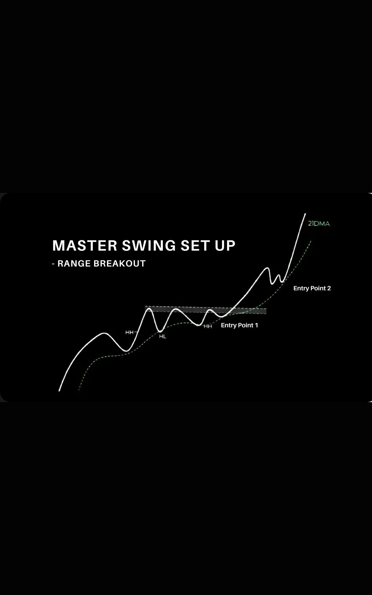

# User's setup reference: Master Swing Set Up / Range Breakout

User supplied this diagram on 2026-10-16 as the intended setup for the Personal Lab. Preserve it as the user's reference rather than assuming the existing experimental VCP heuristic already implements it.

## What the diagram shows

- An advance preceding a consolidation, with higher highs and higher lows marked HH and HL.
- Repeated tests of a horizontal resistance zone, with rising lows within the range.
- A rising dashed average labelled **21DMA**.
- **Entry Point 1** appears around the departure from the consolidation/resistance zone.
- **Entry Point 2** appears after a further advance and a smaller consolidation/pullback near the rising average. This is a separate continuation-entry candidate, not automatically a late first breakout.

These descriptions interpret the illustration; the drawing does not specify executable numerical rules or exact trigger prices. In particular, it does not establish that exactly three contractions, a fixed contraction ratio or a fixed 20-bar high are the user's entry rules. It does not show volume or a stop placement. Do not infer those from the image. Confirm whether 21DMA means a simple or exponential average before treating either as a personal rule.

## Consequences for analysis

Identify the entry family (initial range breakout vs later continuation) before evaluating entry distance. Assess prior trend, the resistance zone, rising lows and position relative to the rising 21-period average using pre-entry data only. A diagram is a reference example, not a trained detector or evidence of validated recognition accuracy.

The current `tradeBaseStructure` check remains an independent experimental shrinking-pullback heuristic. It now reports rising confirmed lows and a clearly labelled 21-period SMA diagnostic. It does not yet implement this full reference or identify Entry Point 2. SMA has not been confirmed as the user's preferred average. Missing evidence must remain unknown, not a verified trading error.

User preference: explain one actionable observation, why it matters and one next-entry check, with details folded by default.
